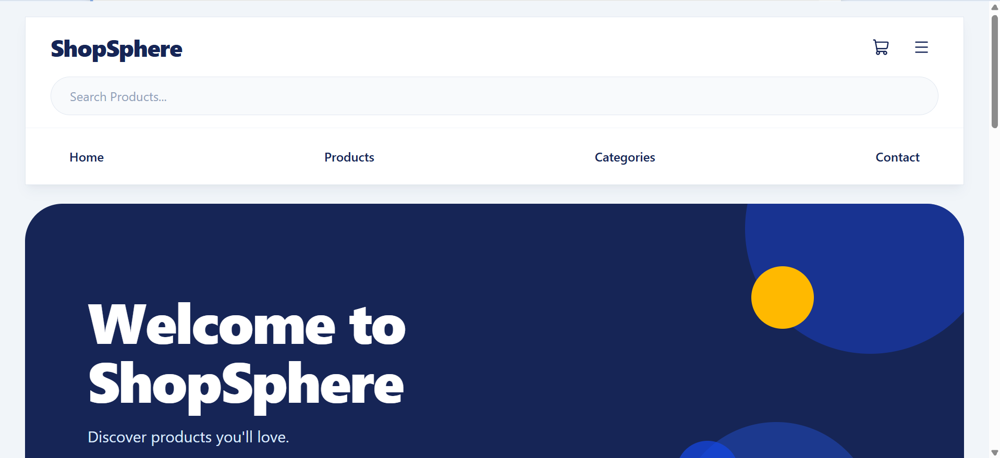
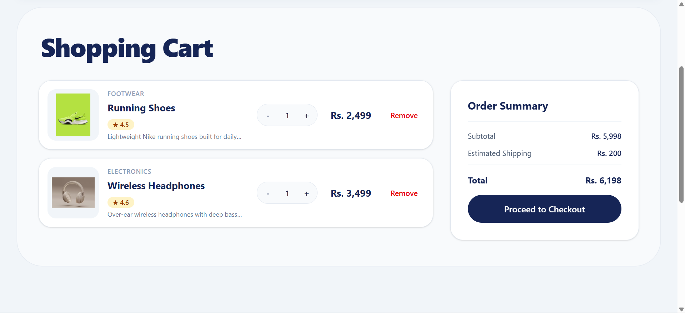
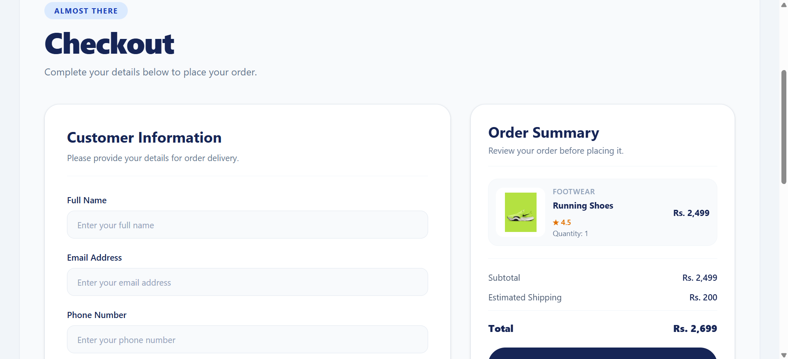
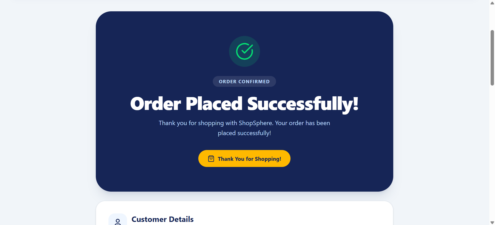

# 🛍️ ShopSphere – Modern E-Commerce Website

ShopSphere is a modern, responsive e-commerce web application built with **React.js** and **Tailwind CSS**. It provides a smooth shopping experience with product browsing, search, category filtering, cart management, and a complete checkout flow.

## 🚀 Live Demo

🔗 **[Visit ShopSphere](https://shopsphere-ten-beige.vercel.app/)**

## 📸 Screenshots

### 🏠 Home Page



### 🛒 Shopping Cart



### 💳 Checkout Page



### 📦 Order Success Page



## ✨ Features

- Responsive design for mobile, tablet, and desktop.
- Product listing with modern UI.
- Search products by name and category.
- Category-based product filtering.
- Individual product details pages.
- Add products to shopping cart.
- Increase and decrease product quantities.
- Remove products from cart.
- Dynamic cart total calculation.
- Complete checkout flow.
- Order placement functionality.
- Order success page with order details.
- React Context API for state management.
- React Router DOM for navigation.
- Lucide React icons.

## 🛠️ Technologies Used

- **React.js** – Frontend library
- **JavaScript (ES6+)** – Application logic
- **Tailwind CSS** – Styling and responsive design
- **React Router DOM** – Client-side routing
- **Context API** – State management
- **Lucide React** – Icons
- **Vite** – Development and build tool

## 📂 Project Structure

```text
ShopSphere/
│
├── public/
│
├── screenshots/
│   ├── home.png
│   ├── cart.png
│   ├── checkout.png
│   └── order-success.png
│
├── src/
│   ├── assets/
│   ├── components/
│   ├── context/
│   ├── data/
│   ├── pages/
│   ├── App.jsx
│   ├── main.jsx
│   └── index.css
│
├── index.html
├── package.json
├── package-lock.json
└── README.md
```

## ⚙️ Installation & Setup

Follow these steps to run ShopSphere locally.

**1. Clone the repository**

<pre><code>git clone https://github.com/abdulrehman-mern/ShopSphere.git</code></pre>

**2. Navigate to the project folder**

<pre><code>cd ShopSphere</code></pre>

**3. Install dependencies**

<pre><code>npm install</code></pre>

**4. Start the development server**

<pre><code>npm run dev</code></pre>

**5. Open in browser**

<pre><code>http://localhost:5173</code></pre>

## 🎯 Project Purpose

ShopSphere was developed as a portfolio project to practice and demonstrate frontend development skills using React.js.

The main focus was on building reusable components, managing application state, implementing routing, creating a functional shopping cart, and designing a responsive user interface.

## 👨‍💻 Developer

**Developed by:** Abdul Rehman

**GitHub:** [Abdul Rehman](https://github.com/abdulrehman-mern)

**Project Repository:** [ShopSphere](https://github.com/abdulrehman-mern/ShopSphere)

---

⭐ If you like this project, consider giving it a star!
